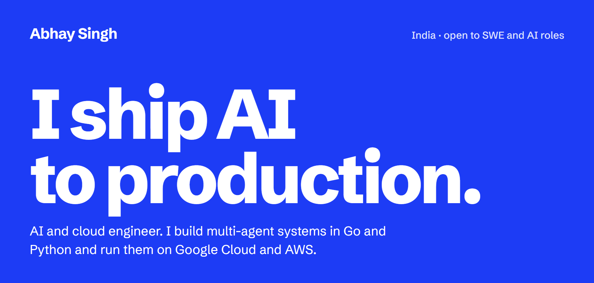
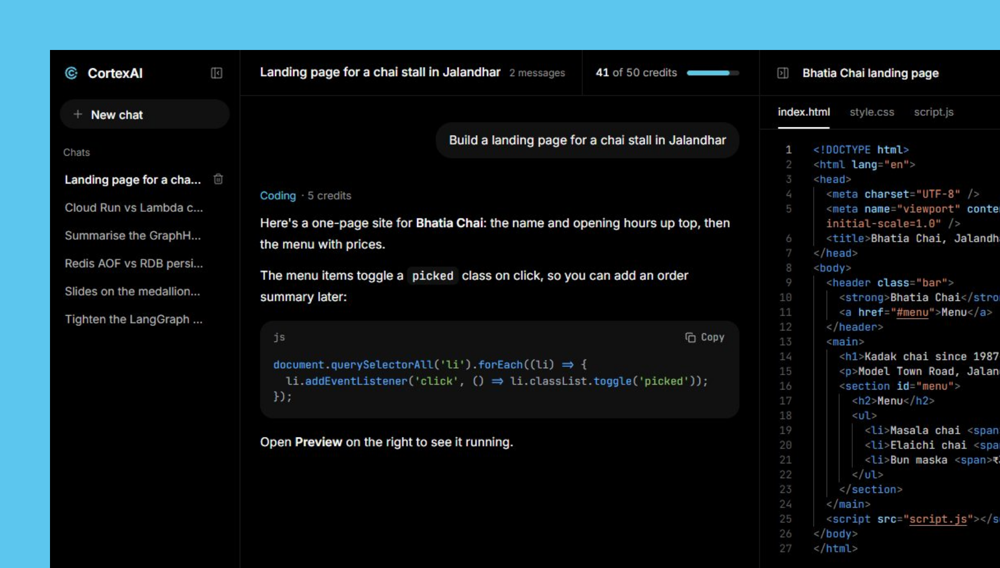
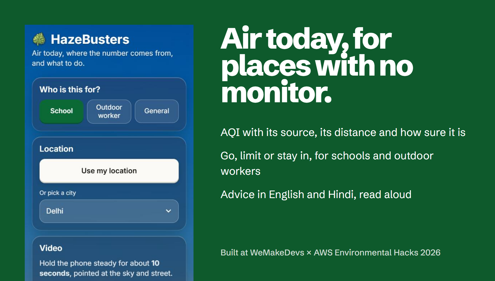
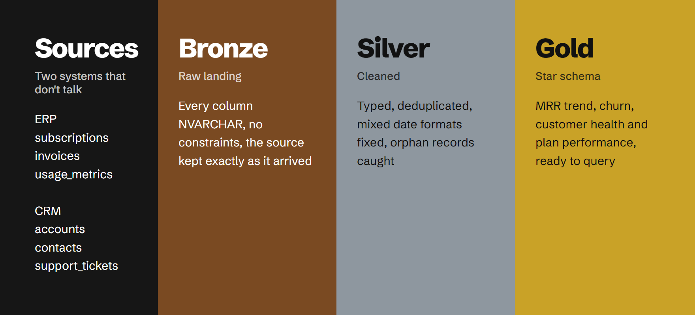

  <a href="https://www.linkedin.com/in/abhaysingh3101"><b>LinkedIn</b></a> &nbsp;·&nbsp;
  <a href="https://drive.google.com/file/d/1RYo5p25qtQkzLTkG0PWpPSXYuQ2l4APo/view?usp=sharing"><b>Resume</b></a> &nbsp;·&nbsp;
  <a href="https://codeforces.com/profile/singhshreyanh312"><b>Codeforces</b></a> &nbsp;·&nbsp;
  <a href="https://github.com/ASR222/neetcode-submissions"><b>NeetCode submissions</b></a> &nbsp;·&nbsp;
  <a href="https://github.com/ASR222/bootdev-progress"><b>Boot.dev progress</b></a>

## Things I've shipped

### CortexAI

One chat box, eight specialist agents. Each message is routed to the one that fits: chat, cited web search, coding with a live preview, questions about your PDFs and images, or a new PDF report, slide deck or image. Go services handle the gateway, auth, chat and billing; a Python LangGraph service runs the agents and streams answers back.

Go · Python · LangGraph · React · MongoDB · Redis · Qdrant · Cloud Run · Terraform

[Try it live](https://cortex-gateway-720170616128.asia-south1.run.app/) &nbsp;·&nbsp; [Read the code](https://github.com/ASR222/cortex-ai)

 

### HazeBusters

Most places have no air-quality monitor nearby. HazeBusters says how far away the nearest reading really is, blends it with the CAMS forecast into a CPCB-style AQI with a confidence level, and tells a school or an outdoor worker whether to go out today. Advice comes in English and Hindi, read aloud by Amazon Polly. Built with a team at the WeMakeDevs × AWS Environmental Hacks 2026.

Python · AWS Lambda · Bedrock · Polly · DynamoDB · S3 · SAM · ONNX · PWA

[Try it live](https://main.dxwuap9t49si3.amplifyapp.com) &nbsp;·&nbsp; [Read the code](https://github.com/ASR222/hazebusters)

 

### NovaCRM data warehouse

A SaaS company keeps billing in its ERP and customers in its CRM, and the two never agree. This SQL Server warehouse lands both as they arrive, cleans them, and builds a star schema that answers MRR, churn and customer-health questions. It ships with a data catalog and tests.

T-SQL · SQL Server · Data modeling · ETL

[Read the code](https://github.com/ASR222/B2B-SaaS-Data-Warehouse-Analytics-SQL-Server)

## Smaller builds

**[Warehouse KPI dashboard](https://github.com/ASR222/Warehouse-KPI-Process-Optimization-Dashboard)**. A four-page Streamlit dashboard for fulfilment operations: KPIs flagged at ±2σ, a Sankey of the warehouse flow, a Lean what-if simulator and root-cause analysis with hypothesis tests. Python, Pandas, SQL, Plotly.

**[Resume Analyzer](https://github.com/ASR222/Resume-Analyzer)**. A REST API that parses PDF resumes and scores them for an ATS across eight dimensions, with OTP sign-up, JWT auth and a local Phi-3 model on Ollama. Node.js, Express, Prisma, PostgreSQL.

## Practice

I'm learning backend development on Boot.dev, solving NeetCode problems and competing on Codeforces. My Boot.dev stats below refresh every night.

<picture>
  <source media="(prefers-color-scheme: dark)" srcset="https://raw.githubusercontent.com/ASR222/ASR222/output/github-snake-dark.svg" />
  
</picture>

## Work with me

I'm looking for software and AI engineering roles, and I like building with other people. The quickest way to reach me is [LinkedIn](https://www.linkedin.com/in/abhaysingh3101).
