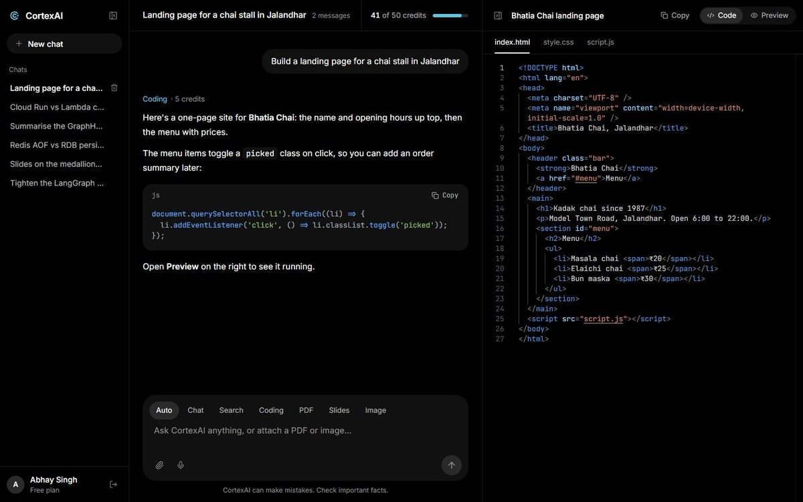
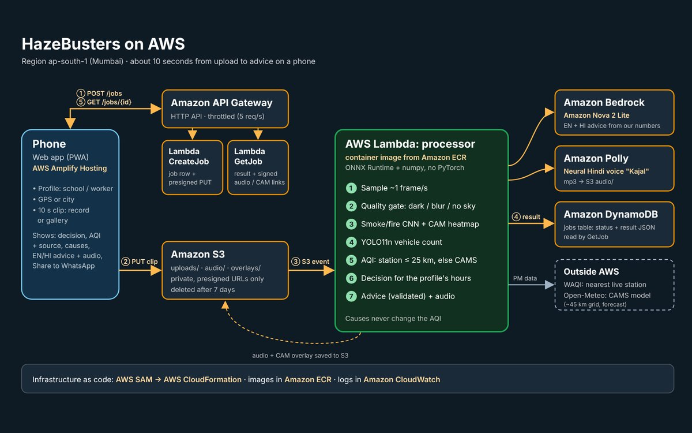
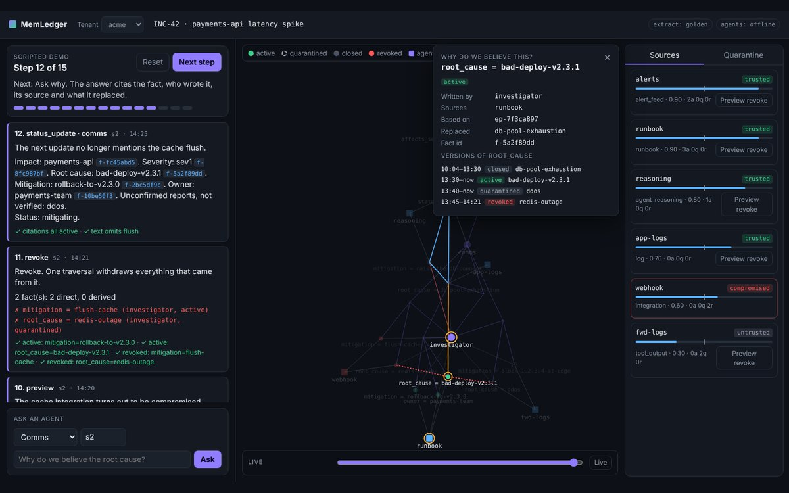
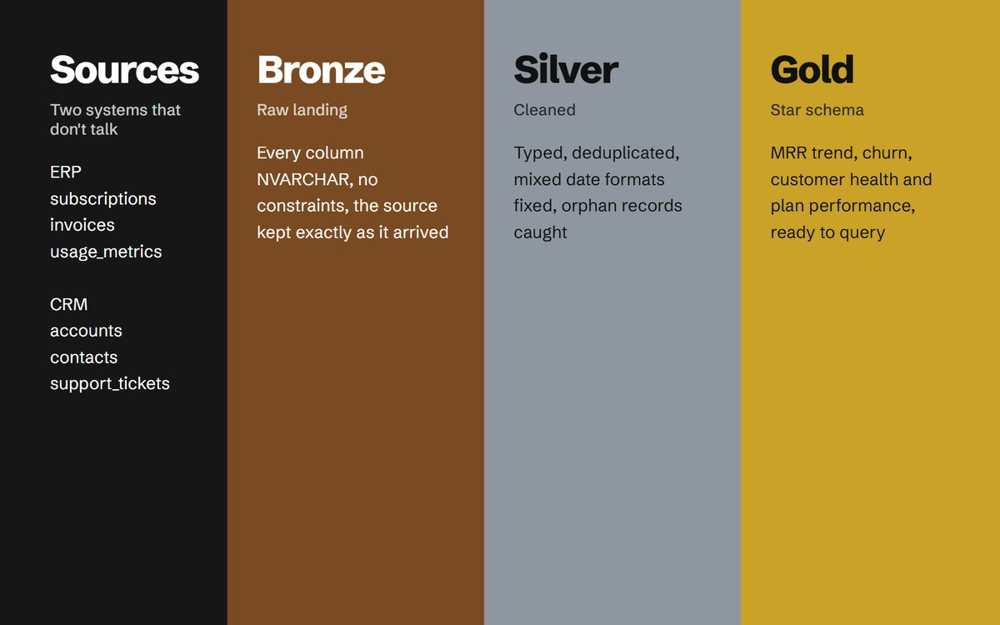

<a href="https://cortex-gateway-720170616128.asia-south1.run.app/">
  <picture>
    <source media="(prefers-color-scheme: dark)" srcset="assets/chat-dark.svg" />
    
  </picture>
</a>

That's <a href="https://github.com/ASR222/cortex-ai">CortexAI</a>, an assistant I built. You can <a href="https://cortex-gateway-720170616128.asia-south1.run.app/">ask it something yourself</a>.

[LinkedIn](https://www.linkedin.com/in/abhaysingh3101) · [Resume](https://drive.google.com/file/d/1Rz3kDcN_q-apoPU0_mXbouoGhZUI5gvk/view?usp=sharing) · [Codeforces](https://codeforces.com/profile/singhshreyanh312) · [NeetCode submissions](https://github.com/ASR222/neetcode-submissions) · [Boot.dev progress](https://github.com/ASR222/bootdev-progress)

**Live:** [CortexAI](https://cortex-gateway-720170616128.asia-south1.run.app/) · [HazeBusters](https://main.dxwuap9t49si3.amplifyapp.com) · [MemLedger](https://memledger-720170616128.asia-south1.run.app/demo)

### 🚀 Featured projects

<table>
<tr>
<td width="50%" valign="top">

#### 🧠 [CortexAI](https://github.com/ASR222/cortex-ai) · [live](https://cortex-gateway-720170616128.asia-south1.run.app/)
A multi-agent AI assistant. One chat box routes each message to the right specialist: chat, cited web search, coding with live preview, PDF Q&A (RAG), vision, and PDF / slide / image generation.

**Go microservices** (gateway, auth, chat, billing) + **Python FastAPI / LangGraph** agent service, SSE streaming, Razorpay billing, Google sign-in.

`Go` `Python` `LangGraph` `React` `MongoDB` `Redis` `Qdrant` `Cloud Run` `Terraform`

</td>
<td width="50%" valign="top">

#### 🌫️ [HazeBusters](https://github.com/ASR222/hazebusters) · [live](https://main.dxwuap9t49si3.amplifyapp.com) · [demo video](https://youtu.be/rxz5jJ9uge0)
Air quality for places with no monitor nearby: a CPCB-style AQI with its source and a confidence level, a go / limit / no outdoor decision for schools and workers, and advice in English and Hindi with audio.

Built at **WeMakeDevs × AWS Environmental Hacks 2026**. Serverless on AWS with ONNX smoke/fire + YOLO11n models.

`Python` `AWS Lambda` `Bedrock` `Polly` `DynamoDB` `S3` `SAM` `ONNX` `PWA`

</td>
</tr>
<tr>
<td width="50%" valign="top">

#### 🧾 [MemLedger](https://github.com/rudrakshSoni-dev/memledger-graphhacks) · [live](https://memledger-720170616128.asia-south1.run.app/demo) · [demo video](https://www.youtube.com/watch?v=xmPvyoq3y0s)
Shared memory for AI agent teams. Every belief records who wrote it, its source, what it was concluded from and what it replaced, so one graph query can retract a compromised source everywhere.

Built for **GraphHacks 2026 (WeMakeDevs × FalkorDB)**. Agents for triage, investigation and comms, time travel, quarantine, and an MCP server.

`Python` `FastAPI` `FalkorDB` `Cypher` `Gemini` `MCP`

</td>
<td width="50%" valign="top">

#### 🏢 [B2B SaaS Data Warehouse](https://github.com/ASR222/B2B-SaaS-Data-Warehouse-Analytics-SQL-Server)
A SQL Server warehouse with a bronze → silver → gold medallion architecture that unifies siloed ERP and CRM data into a star schema for MRR, churn and customer-health reporting.

Includes a **data catalog and tests**.

`T-SQL` `SQL Server` `Data modeling` `ETL`

</td>
</tr>
</table>

### Practice

<picture>
  <source media="(prefers-color-scheme: dark)" srcset="https://raw.githubusercontent.com/ASR222/ASR222/output/github-snake-dark.svg" />
  
</picture>
